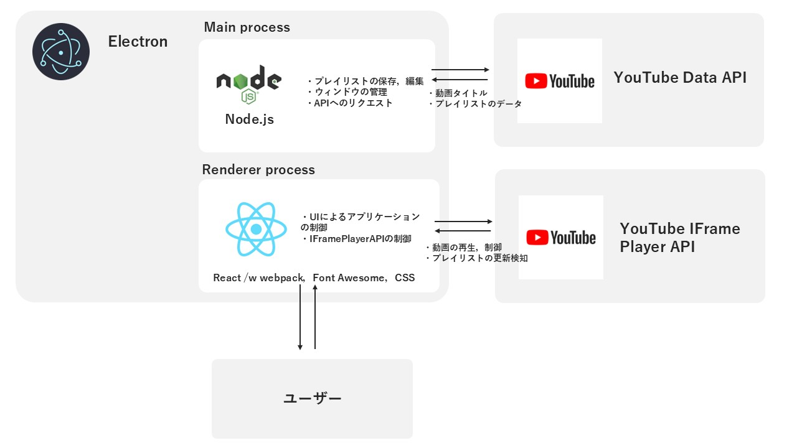
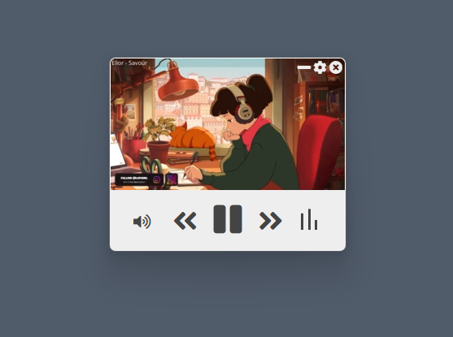
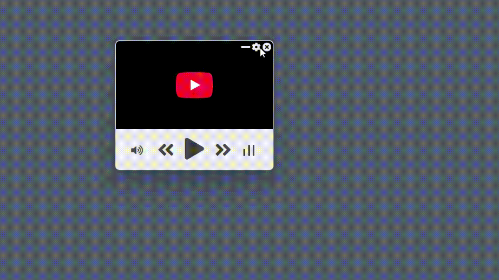
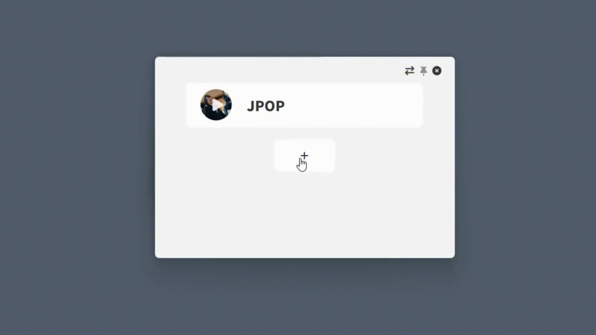
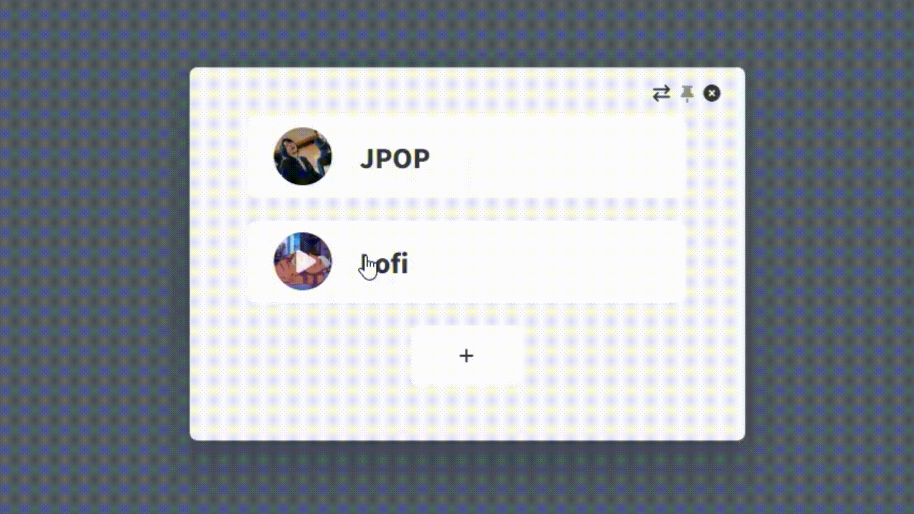

# YoutubeRadio

---

## 使用技術

##### 言語

- Typescript

##### UIフレームワーク

- Electron

##### バックエンド

- Node.js

##### フロントエンド
- Webpack
- React

##### API

- Youtube Data API
- Youtube IFrame Player

##### UIデザイン

- Figma
- Font Awesome

## 機能

- 公式APIによる広告なしでのYoutube上にある動画の再生
- プレイリストの作成，編集，削除，更新
- Youtube上にあるプレイリストの再生

## 開発背景

Youtubeには様々なコンテンツがあり，音楽や作業用BGM，カバーMVなど様々なものがあります．しかし，Youtubeはあくまでビデオ再生するプラットフォームなため，音楽コンテンツを他の音楽プレイヤーのように再生することはできませんでした．そこで，Youtubeにある音楽や動画を手軽に再生できるアプリケーションを作成しようということでこのアプリケーションを作成しました．

## こだわり

シンプルで軽快に動作し，リッチなUIを持つアプリケーションをコンセプトに開発しました．そのため，簡単にリッチなUIを実装できるweb技術を利用できるElectronを選定し開発しました．開発当初はJavascriptとHTML，CSSを利用して実装を行おうとしていましたが，コードが複雑になったため，フロントのフレームワークをReact/Typescriptへとシフトしました．

- 機能面
・クリック可能やドラッグ可能な要素ではカーソルを変化させる．
・画面遷移アニメーションやロード状態を示すアニメーション，要素の削除の遷移アニメーションなど，UIアニメーションを実装．
・UIのデザインを１度Figmaで作成して実装．
・CORSによって特定の動画が再生できないことを回避するため，ローカルサーバを介してUI（ページ）を表示．

- 非機能面：軽快な動作を実現するためにいくつかの工夫を施しました．
・差分アルゴリズムを利用して，APIへのアクセスを最小限にする．
・要素の並べ替え機能ではReactのメモHookやRef Hookを用いて再レンダリングを抑える．
・サムネイル画像をメモリ上に保存しておくことでhttpsリクエスト回数を減らす．

- 開発視点：
・Typescriptを利用して型を導入することで入出力のミスマッチを防ぐほか開発速度の向上を行った．
・ReducerやSuspenceなどを利用して，データの流れを統一することでデータ不整合や制御フローの単純化を行った．
・React，TSXを用いてHTML/CSS，Javascriptの時よりもかなり簡単にUIを実装できるようにした．

- セキュリティ面：
XSSなどによるOS機能へのアクセスを防ぐため，ElectronのPreload機能を用いた限定的なNode.jsのAPIの公開を用いた．

## システム構成

## スクリーンショット

